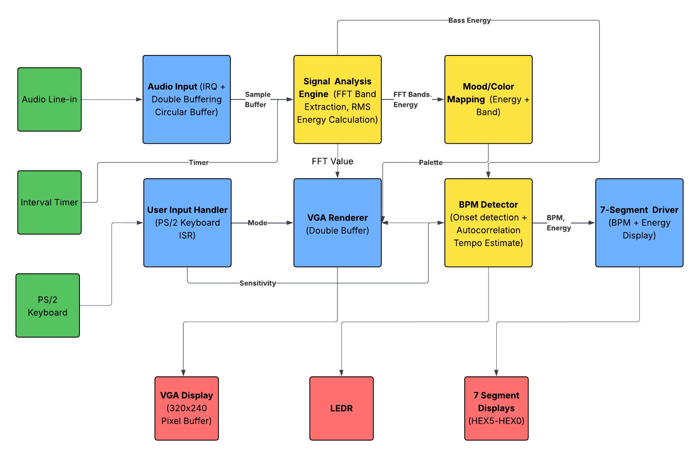

# HexaHertz

**A real-time song analyzer for the DE1-SoC FPGA board.**

Plug music into the board's audio input, and HexaHertz shows the beat, energy and frequency bands live: BPM and energy on the 7-segment displays, an energy bar on the LEDs, and four visual modes on a VGA monitor. It runs entirely on the board's Nios V processor in C, with a fixed-point FFT and no operating system.

Built by **Aidan Tran** and **Joshua Min** for ECE243 (Computer Organization) at the University of Toronto, Winter 2026. Aidan led the project; this repository is a copy of our shared project repo.

## Features

- **Frequency analysis.** A 1024-point radix-2 FFT in Q15 fixed-point (the Nios V has no floating-point unit), with a Hann window, splits audio into bass, mid and treble.
- **Beat and BPM detection.** Energy is tracked in 64-sample hops against a moving baseline, and beat-to-beat intervals are averaged into a BPM estimate.
- **Four visual modes on VGA.** A spectrum visualizer, a three-band bar graph, an oscilloscope-style waveform, and a mood screen with drifting particles (INTENSE, GROOVY or CHILL). A white border flashes on every beat. The display is double-buffered at 320×240.
- **Board displays.** BPM and energy as three-digit numbers on HEX5–HEX0, and an energy bar on the ten LEDs.
- **Keyboard controls** over PS/2 (see below).
- **Built-in test signals** on the slide switches, for checking each part without external audio. See [test_signals.md](test_signals.md).

## Controls

| Key | Action |
|-----|--------|
| `1` | Spectrum visualizer |
| `2` | Band bar graph |
| `3` | Waveform |
| `4` | Mood screen |
| `↑` / `↓` | Make beat detection less / more sensitive |
| `Space` | Pause / resume |
| `R` | Reset the BPM estimate (use when the song changes) |

| SW2 | SW1 | SW0 | Signal |
|-----|-----|-----|--------|
| any | any | 0 | Live audio from line-in |
| 0 | 0 | 1 | 440 Hz tone |
| 0 | 1 | 1 | 220 Hz + 3520 Hz |
| 1 | 0 | 1 | 120 BPM kick pattern |
| 1 | 1 | 1 | Bass-to-treble sweep |

## Running it

1. Connect the DE1-SoC to a VGA monitor and a PS/2 keyboard, and plug an audio source into the blue line-in jack.
2. Compile `src/main.c` for the Nios V and load it onto the board (for example with the Intel FPGA Monitor Program). It also runs in the CPUlator simulator, at an 8 kHz sample rate.
3. Play music. BPM settles after a few seconds of steady rhythm.

## Who built what

| Aidan Tran | Joshua Min |
|------------|------------|
| Audio codec setup and input | PS/2 keyboard state machine and key mapping |
| Q15 FFT, energy and band extraction | 7-segment display driver |
| Beat / BPM detection and mood classification | LED energy bar |
| VGA double-buffering and all four visual modes | Display smoothing and decay |
| Test signal generator | Project plan and block diagram |

Code documentation was shared. Full details are in [docs/final_report.md](docs/final_report.md), and a walkthrough of the code is in [docs/main_c_breakdown.md](docs/main_c_breakdown.md).

More about the project: [joshmin.me](https://joshmin.me)
